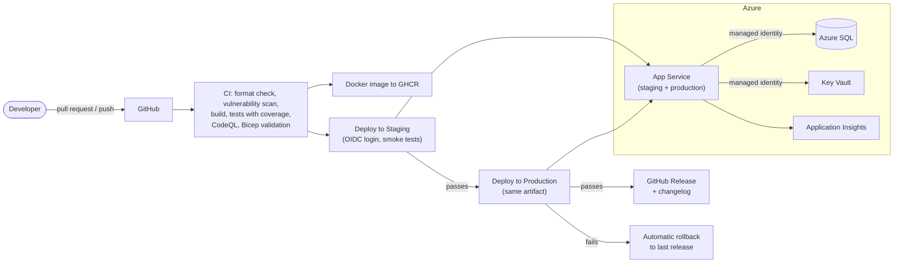

# MyApi: Time Zone API

[](https://github.com/birupakhya2000/MyApi/actions/workflows/dotnet.yml)
[](https://github.com/birupakhya2000/MyApi/actions/workflows/codeql.yml)

A .NET 10 Minimal API that returns the current time in any time zone, with user accounts and saved favorite zones. The application is deliberately small. The point of the project is the **delivery pipeline and production practices** around it.

**Live:** https://myapi-time-birupakhya-eke3dpavctbhb3h9.centralindia-01.azurewebsites.net/scalar

## Architecture



## What's in it

**API**
- Time and time zone endpoints, documented with OpenAPI and Scalar
- JWT authentication, passwords hashed with ASP.NET's `PasswordHasher`
- Per-user favorites, always filtered by the user ID from the token
- Input validation, RFC 7807 ProblemDetails errors, rate limiting, CORS, security headers
- Liveness (`/health`), readiness (`/health/ready`) and `/version` endpoints

**Pipeline (GitHub Actions)**
- Format check, NuGet vulnerability scan, build, tests with coverage report
- Build once, deploy the same artifact to Staging, then Production
- Smoke tests after each deploy, including verifying the new version is live
- Passwordless Azure login with OIDC federated credentials
- Automatic GitHub Release with changelog; automatic rollback if production fails
- CodeQL analysis, Dependabot updates, Docker image published to GHCR

**Azure**
- App Service, Azure SQL (free offer), Key Vault, Application Insights
- Managed identities for database and Key Vault access: no passwords in settings
- Infrastructure defined in Bicep (`infra/main.bicep`)

**Testing**
- xUnit integration tests with `WebApplicationFactory` and a fake clock
- A SQL Server Testcontainers test that applies the real migrations

## Run locally

```
dotnet run --project src/MyApi.Api
```

Open `/scalar`. Local development uses SQLite.

## Run the tests

```
dotnet test
dotnet test --filter "Category!=SqlServer"   # skip the Docker-based test
```

## Design decisions

- **Build once, deploy twice**: the exact tested package goes to production.
- **Rollback redeploys the last release**, because deployment slots need a paid tier.
- **Liveness and readiness are separate**, so health pings don't keep the auto-pausing free database awake.
- **Rollback doesn't undo migrations**, so migrations must be backward compatible.
- **The infrastructure pipeline is manual and separate**: the deploy identity can't assign roles, by design.
